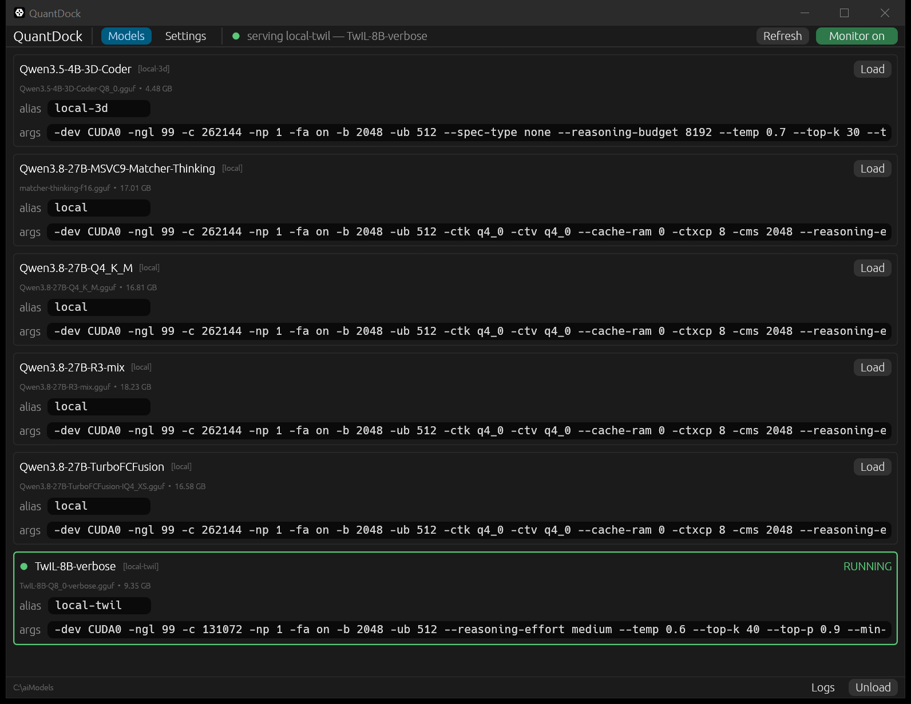
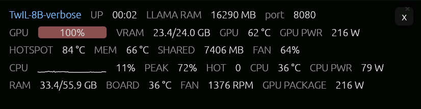

# Install QuantDock

QuantDock is two Windows executables: `quantdock.exe` (manager) and `monitor.exe`
(overlay). The quickest path is to paste the prompt below to your local agent. If you
want to do it yourself, the four steps in **Quick start** are enough; everything after
that is reference.

## Quick start (human)

1. Download `quantdock.exe` and `monitor.exe` from the
   [latest release](https://github.com/konqiDAM/QuantDock/releases/latest) into one
   folder, e.g. `C:\Tools\QuantDock`.
2. Put a GGUF model in its own folder under `C:\aiModels`, e.g.
   `C:\aiModels\My-Model\My-Model.Q4_K_M.gguf`.
3. Let your agent create the one small config file (`My-Model.toml`) using the prompt
   below, or copy the template in [Advanced configuration](#advanced-configuration).
4. Run `quantdock.exe`, press **Load** on the model card, then **Monitor** for the
   overlay.



*The manager: model cards, Load, Monitor, and Logs. The long `args` line is optional
tuning; a new model starts with a safe default.*



*The overlay: live GPU, CPU, RAM and LibreHardwareMonitor sensors. It is always-on-top
and does not appear in the taskbar.*

You only need two per-model fields: `alias` (which OpenCode entry serves it) and `args`
(llama-server flags). The defaults are fine for a first run. The manager's card edits
both; `name` and `gguf` are set when the model is added.

## Paste this to your local agent

> You are installing QuantDock on this Windows machine. Read
> `https://raw.githubusercontent.com/konqiDAM/QuantDock/main/INSTALL.md` first and follow
> it step by step.
>
> Goals: install the latest QuantDock release, choose a models folder, make sure
> `llama-server.exe` is available, add one GGUF model from Hugging Face with its `.toml`,
> and verify that QuantDock loads it and the overlay shows values.
>
> Use `C:\Tools\QuantDock` for the app and `C:\aiModels` for models unless I say
> otherwise. Ask me for the Hugging Face repo and file before downloading a multi-GB
> model. Do not delete or overwrite existing models, configs, or model weights. Report
> the exact paths and the verification result.

## Adding one model later

Paste this and fill in the model details:

> Add this GGUF model to QuantDock on Windows. Read `INSTALL.md` for the full procedure.
> Hugging Face repo: `<owner/repo>`; file: `<file.gguf>`; folder: `C:\aiModels\<Model>`;
> alias: `<local | local-3d | local-twil | new-alias>`; context: `<n>`; extra flags:
> `<flags>`. Download the file, create `<folder>\<Model>.toml`, load it in QuantDock, and
> verify `/v1/models` and the log console.

## What the agent should verify

- [ ] `quantdock.exe` and `monitor.exe` are in the same folder.
- [ ] The models root exists and the app can see it.
- [ ] `llama-server.exe --version` works, or the LM Studio backend exists.
- [ ] The model folder contains the `.gguf` and `<folder>.toml`.
- [ ] The TOML `gguf` matches the actual filename and `alias` is correct.
- [ ] QuantDock shows the model card and **Load** turns green.
- [ ] `http://127.0.0.1:8080/v1/models` returns the alias.
- [ ] The overlay shows values; LHM fields are live if LHM is enabled.
- [ ] OpenCode's model id reaches the running model.
- [ ] The Logs panel shows server output without errors.

## 1. Install QuantDock

### From the latest release (recommended)

```powershell
$app = "$env:LOCALAPPDATA\QuantDock"
New-Item -ItemType Directory -Force $app | Out-Null
$base = "https://github.com/konqiDAM/QuantDock/releases/latest/download"
Invoke-WebRequest "$base/quantdock.exe" -OutFile "$app\quantdock.exe"
Invoke-WebRequest "$base/monitor.exe" -OutFile "$app\monitor.exe"
Start-Process "$app\quantdock.exe"
```

The two exes must stay in the same folder; the manager starts `monitor.exe` from its
own folder.

### Build from the latest tag

```powershell
git clone --branch v0.1.0 https://github.com/konqiDAM/QuantDock.git
cd QuantDock
cargo build --release
# target\release\quantdock.exe and monitor.exe
```

Any `v*` tag publishes a GitHub Release with both exes. To build the newest code instead,
clone `main`; the tag is the stable install point.

## 2. Choose the models folder

The app scans `C:\aiModels` by default. To use another folder, set a per-user environment
variable and restart the app:

```powershell
[Environment]::SetEnvironmentVariable("QUANTDOCK_MODELS", "D:\aiModels", "User")
```

One model per folder:

```
<models root>\
  <Model Name>\
    <file>.gguf
    <Model Name>.toml     <- must have exactly this name
```

The app skips a folder unless `<folder>\<folder>.toml` exists and parses. It also skips
a folder named `old`.

## 3. Install llama-server

QuantDock looks for `llama-server.exe` in this order:

1. `QUANTDOCK_LLAMA` (a full path to the exe).
2. The newest `llama.cpp-*` backend under
   `%USERPROFILE%\.lmstudio\extensions\backends\`.
3. `llama-server.exe` on `PATH`.

**If LM Studio is installed**, you usually do nothing: the backend is found
automatically.

**If you use llama.cpp directly**, download a Windows release from
<https://github.com/ggml-org/llama.cpp/releases>, extract it, and point QuantDock at it:

```powershell
[Environment]::SetEnvironmentVariable(
  "QUANTDOCK_LLAMA",
  "C:\Tools\llama.cpp\llama-server.exe",
  "User")
```

Restart QuantDock after changing the variable. A CUDA build needs a matching NVIDIA
driver; the CPU build is a useful first test. QuantDock adds `-m <gguf> -a <alias>
--port 8080` itself, so only put extra flags in `args`.

## 4. Download a model from Hugging Face

Install the Hugging Face CLI once:

```powershell
python -m pip install -U huggingface_hub
```

Pick a GGUF repo and a quantisation that fits your VRAM (Q4_K_M is a common 24 GB
choice; Q8_0 for small models). Example for the R3-mix model used on this machine:

```powershell
$model = "Qwen3.8-27B-R3-mix"
New-Item -ItemType Directory -Force "C:\aiModels\$model" | Out-Null
hf download jdominick05/Qwen3.8-27B-24GB-262k-GGUF `
  Qwen3.8-27B-R3-mix.gguf `
  --local-dir "C:\aiModels\$model"
```

`huggingface-cli download` works too on older installs. You can also download from the
Hugging Face website or LM Studio and move the `.gguf` into the folder. For vision
models, put the matching `mmproj-*.gguf` in the same folder and add `--mmproj <absolute
path>` to `args`.

Verify the file size before loading; a partial download will fail in llama-server.

## Advanced configuration

You do not need this section for a first run. The agent writes a safe default; tune it
only when you want a different context, VRAM fit, or sampling.

Create `C:\aiModels\<Model Name>\<Model Name>.toml`:

```toml
# Display name in the manager.
name = "Qwen3.8-27B-R3-mix"

# GGUF filename, relative to this folder.
gguf = "Qwen3.8-27B-R3-mix.gguf"

# Served model id. Models sharing an alias form one OpenCode entry.
alias = "local"

# Raw llama-server flags, one line. The app adds -m, -a and --port 8080.
args = "-dev CUDA0 -ngl 99 -c 262144 -np 1 -fa on -b 2048 -ub 512 -ctk q4_0 -ctv q4_0 --cache-ram 0"
```

Common `args`:

- `-ngl 99` — put all layers on the GPU.
- `-c 32768` — context size; lower it if VRAM is tight.
- `-fa on` — flash attention.
- `-ctk q4_0 -ctv q4_0` — quantised KV cache; needs flash attention.
- `-np 1` — one parallel slot, enough for one agent.
- `--mmproj <path>` — vision projector for multimodal models.

Keep `args` on one line and inside double quotes. The manager's model card can edit
`alias` and `args` and write them back to the TOML; changing `name` or `gguf` is a
file edit. The alias must match an OpenCode model id if you want to reach it from
OpenCode. The three existing groups are `local`, `local-3d`, and `local-twil`.

## Overlay setup (optional)

After the first launch, Settings -> **Fields** -> **Configure available sensors…** lists
every built-in field and every live LibreHardwareMonitor sensor. The sensor window
groups live sensors by CPU, GPU, memory, board, storage and network, then by sensor
type, so a `CPU Package` temperature is shown under its own hardware. Tick the ones
you want and pick the target row. The **Custom sensor fields** table edits their
labels, bars and warning thresholds. **Profiles** stores the whole overlay setup in one of ten slots;
loading a profile asks before replacing an unsaved layout. Sensor paths and intervals
stay machine settings and are not stored in a profile. The manager's body text stays
left-aligned at any window width.

## 5. Start and verify

1. Run `quantdock.exe`.
2. The model card should appear. Press **Load**.
3. A yellow border means loading, green means serving. The log console (**Logs**) shows
   the server output and the last error if it fails.
4. Press **Monitor** to start the overlay. It is always-on-top, transparent, and does not
   appear in the taskbar.
5. Verify the API:

```powershell
Invoke-RestMethod http://127.0.0.1:8080/v1/models
```

Only one llama-server runs at a time. Loading another model stops the current one.

## 6. Hardware monitor (optional)

CPU temperature, CPU package power, board temperature, GPU hotspot, GPU memory junction
and shared memory come from LibreHardwareMonitor (LHM).

1. Open **Settings** -> **Hardware sensors**.
2. Press **Download** (pinned LHM release) or **Use this path** for an existing
   `LibreHardwareMonitor.exe`.
3. Press **Start it** and accept the UAC prompt. LHM must run as administrator to read
   hardware; it starts minimized with its web server on port 8085.
4. Optional: enable **Start LibreHardwareMonitor with QuantDock**. It is one-shot per
   launch; cancelling UAC is not retried until the next launch.
5. The LHM fields show `--` until the state says connected. If LHM is running and they
   still show `--`, open `http://127.0.0.1:8085/data.json` and restart the overlay.

The LHM parser accepts escaped JSON (`\u00B0`). The sampler refreshes LHM every
`sensors.interval_ms` (default 2 s) and reuses the last good values on every display
tick; a failed refresh keeps them for 10 s, then shows `--`.

## 7. OpenCode

Add the provider to `%USERPROFILE%\.config\opencode\opencode.json`:

```json
"local": {
  "npm": "@ai-sdk/openai-compatible",
  "name": "Local (llama.cpp)",
  "options": {
    "baseURL": "http://127.0.0.1:8080/v1",
    "apiKey": "sk-no-key"
  },
  "models": {
    "local": { "name": "Local (Qwen3.8-27B, 262K)" },
    "local-3d": {
      "name": "Local (3D Coder, 262K)",
      "limit": { "context": 262144, "output": 65536 },
      "modalities": { "input": ["text", "image"], "output": ["text"] },
      "attachment": true
    },
    "local-twil": { "name": "Local (TwIL-8B, 131K)" }
  }
}
```

The provider id and the `models` ids are alias entry points, not proof of what is
loaded. llama-server accepts any model id and serves the model currently loaded. For a
new alias, add a model id here and use the same `alias` in the model TOML.

## Troubleshooting

**"llama-server.exe not found"** — install an LM Studio backend or set
`QUANTDOCK_LLAMA` to the exe, then restart QuantDock.

**Model not in the list** — the folder must be directly under the models root, contain
`<folder>.toml`, and that TOML must parse. `old` folders are skipped. Press **Refresh**.

**Load fails** — open **Logs** and read `llama-server.log`. Common causes: a bad flag
(especially `--port`, which needs two dashes), not enough VRAM, a partial GGUF, or a
context size larger than the model supports.

**All LHM fields show `--`** — LHM is not connected, not running as admin, or its web
server is off. Check `http://127.0.0.1:8085/data.json`; see the manager's Hardware
sensors state; restart the overlay.

**Port 8080 in use** — unload the current model first; only one llama-server is
supported.

**Overlay hidden** — it has no taskbar entry by design. Use the manager's **Monitor**
button; another always-on-top window (including OpenCode) can paint over it. **Reset
position** is in Settings.

**Wrong scaling/position** — the overlay uses physical pixels; on a 150% display, use
**Reset position** after changing monitors.

**QuantDock closed unexpectedly** — the panic hook writes a backtrace to
`%APPDATA%\QuantDock\crash.log`; include that file in a bug report.

The model catalogue and tuning notes for this machine are in `C:\aiModels\README.md`.
