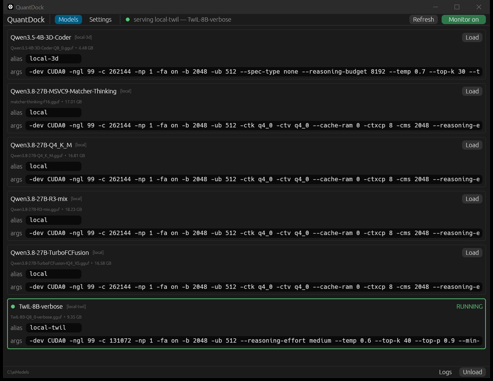

# QuantDock

A lightweight desktop manager for local GGUF models (llama.cpp / `llama-server`) on Windows.

## What it does

- **Load / unload** models from one list, no launcher scripts
- **Per-model config files** — tune context, sampling, KV cache and speculative decoding by
  editing one `.toml`
- **Shows what is *actually* running** — llama-server accepts any model id, so the label is
  not proof. QuantDock reads `/props` and resolves the real GGUF.
- **Floating resource monitor** — transparent, always-on-top, with rows you arrange yourself
- **Downloads GGUF models from Hugging Face** — paste a repo id or link, pick a file, cancel
  any time
- **Lives in the tray** — closing the window keeps the model serving; the tray starts and
  stops the overlay and quits the app
- **Three OpenCode entries** — `local`, `local-3d`, `local-twil`, one per model group

## Screenshots



*The manager: model cards, Load, Monitor, and Logs.*


*The floating overlay: live GPU, CPU, RAM and LibreHardwareMonitor sensors.*

## Stack

Rust + [egui](https://github.com/emilk/egui) (`eframe`, OpenGL via `glow`). No Node, no
bundled webview — two small native binaries.

## Install

Two ways: paste a prompt to your local agent, or do it by hand.

### Let an agent install it

> You are installing QuantDock on this Windows machine. Read
> `https://raw.githubusercontent.com/konqiDAM/QuantDock/main/INSTALL.md` first and
> follow it step by step.
>
> Goals: install the latest QuantDock release, choose a models folder, make sure
> `llama-server.exe` is available, add one GGUF model from Hugging Face with its
> `.toml`, and verify that QuantDock loads it and the overlay shows values.
>
> Use `C:\Tools\QuantDock` for the app and `C:\aiModels` for models unless I say
> otherwise. Ask me for the Hugging Face repo and file before downloading a
> multi-GB model. Do not delete or overwrite existing models, configs, or model
> weights. Report the exact paths and the verification result.

### Manual install

1. Download `quantdock.exe` and `monitor.exe` from the
   [latest release](https://github.com/konqiDAM/QuantDock/releases/latest) into one
   folder, e.g. `C:\Tools\QuantDock`. The manager starts `monitor.exe` from its own
   folder, so keep them together.
2. Put each model in its own folder under `C:\aiModels` (see **Layout convention**
   below), e.g. `C:\aiModels\My-Model\My-Model.Q4_K_M.gguf` plus a
   `My-Model.toml`. The TOML needs `name`, `gguf` and `alias` for a first run; the
   template is in `INSTALL.md` under **Advanced configuration**. The manager can do the
   download and the TOML itself — see **Add a model from Hugging Face** below.
3. `llama-server.exe` is found automatically in the LM Studio backends directory.
   If you use llama.cpp directly, set `QUANTDOCK_LLAMA` to the exe's full path.
4. Run `quantdock.exe`, press **Load** on the model card, then **Monitor** for the
   overlay. Hardware sensors are optional — see **Hardware sensors** below.

### Adding a model later

Paste this to your agent and fill in the model details:

> Add this GGUF model to QuantDock on Windows. Read `INSTALL.md` for the full
> procedure. Hugging Face repo: `<owner/repo>`; file: `<file.gguf>`; folder:
> `C:\aiModels\<Model>`; alias: `<local | local-3d | local-twil | new-alias>`;
> context: `<n>`; extra flags: `<flags>`. Download the file, create
> `<folder>\<Model>.toml`, load it in QuantDock, and verify `/v1/models` and the
> log console.

## Build

```sh
cargo build --release
```

Produces `target/release/quantdock.exe` (the manager) and `target/release/monitor.exe`
(the overlay). Both are GUI-subsystem binaries — no console window.

## Using it

Launch **`quantdock.exe`** and leave it running — closing its window keeps it in the tray;
the overlay starts from its **Monitor** button.

- **Monitor** is neutral when the overlay is closed, green ("Monitor on") while it runs,
  red ("Close") when hovered, and closes it on click.
- **Logs** opens a console docked at the bottom of the main window. It shows the last 200
  lines of the current model's `llama-server.log`, keeps following the newest line unless
  you scroll up, and stays on the last loaded model after the server exits. It never
  clears or edits the file.
- **Model cards**: a yellow border while a model is loading, green while it is serving.
- **Download** (Models tab) opens the Hugging Face downloader — see
  **Add a model from Hugging Face** below.
- **Settings** tab: overlay width, interval, opacity, font size, rows, profiles, fields,
  colours and thresholds, in a centered 640 px column that narrows to fit a small window.
- Body text, tables and the preview stay left-aligned at any window width; only action
  buttons sit on the right.

## Tray icon and closing

While it runs, QuantDock keeps an icon in the notification area. Left click it for the
menu:

- **Show QuantDock / Hide QuantDock** — show the window, or hide it (even while it is
  minimized).
- **Start monitor / Close monitor** — starts or stops the overlay. The label follows the
  overlay's live state.
- **Exit** — quits everything, as described below.

Closing the window with **X** hides it to the tray instead of quitting, so llama-server
keeps serving and an unsaved Settings draft is kept. Bring the window back with **Show
QuantDock**.

**Exit** is the full stop: it asks *Exit without saving settings?* when the Settings draft
has unsaved changes, cancels a running download (waiting at most 5 seconds), closes the
overlay, and closes the window. A llama-server that is already running is left running —
press **Unload** first if you want it stopped too.

Hovering the icon shows the state: `QuantDock — serving local — Qwen3 8B · monitor up`, or
`server down` in place of the model when nothing is loaded.

If the tray icon cannot be created, the app says so and **X** stays a real close, so
nothing can hide where you cannot reach it.

Starting a second `quantdock.exe` while one is already running only shows the existing
window; the second process exits.

Settings -> **Manager** -> **Start hidden to tray** starts the next launch hidden with the
tray icon present; **Show QuantDock** reveals it. It needs the tray icon: a launch without
one opens the window as usual.

## Add a model from Hugging Face

Models tab -> **Download**. Paste a repo id (`owner/name`) or any huggingface.co link — a
repo, or a `tree`, `blob` or `resolve` link with its branch — and press **Fetch files**.
The dialog lists the repo's `.gguf` files with their sizes; pick one and press
**Download**. Progress shows MB and percent (bytes only until the size is known), and
**Cancel** stops it.

A successful download writes `<models root>\<RepoName>\<repo path>` plus
`<RepoName>.toml` with `alias = local` and empty `args`; the card appears straight away,
and the alias and args are edited on the card like any other model. If `<RepoName>`
already holds anything, the download goes into `<RepoName>-2` (then `-3`, …) instead of
merging into it. A folder named `old` is never used, because discovery skips it.

Worth knowing:

- Gated and private repos are not supported — there is no sign-in. A gated or moved repo
  answers with an HTML page instead of the file; the app rejects it as "not a GGUF file"
  and keeps nothing.
- The listing is one page: Hugging Face caps tree listings at 1000 entries, so a very
  large repo may not list all of its GGUFs. The CLI in `INSTALL.md` has no such limit.
- No resume and no split-GGUF support: each shard would become its own separate model, so
  download a single-file quant.
- There is no total-time limit, so a slow but healthy multi-GB download finishes; a
  connection that sends nothing for a minute fails instead of hanging.

Cancelling deletes the partial file. Quitting mid-download cancels it (the app waits at
most 5 seconds), and the next launch deletes any model folder that holds nothing but
`*.gguf.part` files. That sweep also matches a half-finished manual download with the same
suffix in the models root — rename such a file if you want to keep it.

## Overlay configuration

Everything lives in `%APPDATA%\QuantDock\settings.toml`; the GUI writes it, and hand edits
are picked up within a second. A malformed file is never overwritten — the app shows the
parse error and offers a reset.

<details>
<summary>settings.toml example</summary>

```toml
[monitor]
width = 320            # px; 0 = fit the widest row exactly
interval_ms = 1000
background_alpha = 190 # 0..255
corner_radius = 0
font_size = 13
show_labels = true
always_on_top = true
show_close = true
position = "top-right"
margin = 16
graph_samples = 60
title = ""             # optional label shown above the rows

[[monitor.rows]]
fields = ["model", "uptime", "llama_ram"]

[[monitor.rows]]
fields = ["gpu", "vram", "gpu_temp", "power"]

[[monitor.rows]]
fields = ["gpu_hotspot", "gpu_mem_temp", "gpu_shared", "fan"]

[[monitor.rows]]
fields = ["cpu", "cpu_peak", "cpu_hot", "cpu_temp", "cpu_power"]

[[monitor.rows]]
fields = ["ram", "board_temp"]

[thresholds.gpu_temp]
warn = 70
crit = 82

[monitor.field_style]
gpu = "bar"
cpu = "graph_text"
```

</details>

An empty row is a spacer. Field styles are `text`, `bar`, `graph` and `graph_text`; bars
need a natural scale (percentages and memory pairs), and text-only fields ignore them.

**Fields:** `model`, `alias`, `ctx`, `gpu`, `vram`, `vram_pct`, `vram_bus`, `gpu_temp`,
`fan`, `fan_rpm`, `power`, `clock`, `pstate`, `gpu_hotspot`, `gpu_mem_temp`, `gpu_shared`,
`cpu`, `cpu_peak`, `cpu_hot`, `cpu_temp`, `cpu_power`, `ram`, `ram_pct`, `swap`,
`llama_ram`, `disk_free`, `uptime`, `port`, `board_temp`.

The window position is remembered in `%APPDATA%\QuantDock\window.toml`; "Reset position"
in Settings deletes it.

## Hardware sensors (optional)

CPU temperature, CPU package power, motherboard temperature, GPU hot spot, GPU memory
junction and shared GPU memory come from **LibreHardwareMonitor**, which Windows does not
provide natively.

Settings -> **Hardware sensors**:

- **Download** fetches the pinned LibreHardwareMonitor release into
  `%APPDATA%\QuantDock\LibreHardwareMonitor` and pre-enables its web server.
- **Use this path** points at an existing `LibreHardwareMonitor.exe`.
- **Start it** launches it; Windows asks for administrator because it reads hardware
  directly. Decline and those fields simply show `--`.
- **Start LibreHardwareMonitor with QuantDock** does that launch automatically on the next
  start. It is off by default because each launch shows the UAC prompt; enable it only
  when you want sensors live without pressing **Start it**. If you cancel UAC, it is not
  retried until the next launch.
- Once connected, its fields become live. They are read from
  `http://127.0.0.1:8085/data.json` and matched by `HardwareId`/`SensorId`, so AMD and
  Intel machines both work.
- LibreHardwareMonitor escapes `°` as `\u00B0`; the parser accepts escaped values. The
  sampler reads LHM every `sensors.interval_ms` (default 2 s) but reuses the last good
  reading on every display tick. A failed refresh keeps the values for 10 s, then shows
  `--`.

## Layout convention (models)

```
<Model Name>/
  <model>.gguf
  <Model Name>.toml     <- per-model config (edit this, not a launcher)
```

The model root defaults to `C:\aiModels`; override with `QUANTDOCK_MODELS`.
`llama-server.exe` is found in the LM Studio backends directory (highest version wins);
override with `QUANTDOCK_LLAMA`.

## Aliases and OpenCode

| alias | OpenCode entry | models |
|---|---|---|
| `local` | Local (Qwen3.8-27B, 262K) | R3-mix, Q4_K_M, TurboFCFusion, MSVC9 Matcher |
| `local-3d` | Local (3D Coder, 262K) | Qwen3.5-4B-3D-Coder |
| `local-twil` | Local (TwIL-8B, 131K) | TwIL-8B-verbose |

## Memory

QuantDock's own heap is flat: a 10-minute run and a Rust heap counter show no retained
application allocations. The process commit still grows about 3 MB/min because the NVIDIA
OpenGL driver keeps GPU backing store; a xperf `VIRT_ALLOC` trace attributes it to
`nvoglv64` / `dxgmms2`, not to QuantDock. The churn fixes (zero-allocation RAM/swap read,
5 s process refresh, 3 s server-status cache, shared LibreHardwareMonitor reader, halved
repaint rates) cut the app's own allocations by 24-65%. This is accepted as a driver
floor, not a leak in the application.

## Sensors, custom fields and profiles

Under Settings -> **Fields**, press **Configure available sensors…**. The window lists
every built-in field and every sensor LibreHardwareMonitor reports, with a search box and
a target row. Tick a field to add it to that row; untick it to remove it from every row.
Unticking keeps the field's label, style and thresholds, so ticking it again restores
them. A stored custom sensor the machine no longer reports stays listed under **Stored /
missing** and shows `--` in the overlay; it is never remapped.

Live LibreHardwareMonitor sensors are grouped the way the monitor shows them:
CPU, GPU, Memory, Board, Storage, Network and Other, then the hardware name, then
Temperatures, Powers, Clocks, Load, Voltages, Fans, Controls, Data or
Throughput. Nested board chips stay nested. CPU and GPU open first, with their
Temperatures group; the other categories stay collapsed. Search matches sensor
names, ids, groups and hardware names and opens matching branches.

The **Custom sensor fields** table below the built-in table edits each stored custom
sensor: label, style (`text`, or `bar` for `/load/` sensors), warn, crit and direction.
**Forget** removes it from every row and deletes its stored label, style and thresholds.
For a SensorId LibreHardwareMonitor is not currently reporting, use **Add by SensorId**
below the table; it is stored and shows `--` until the sensor appears.

**Profiles** saves the whole overlay setup into one of ten slots: rows, custom sensors,
field styles, thresholds, colours, width, interval, opacity, font, corner radius, margin,
graph samples, show-labels, position, title and the always-on-top/close-button flags.
Loading a profile when the current layout does not match any saved slot asks for
confirmation. The dialog offers only **Load anyway** and **Cancel**; Load anyway also
discards unsaved overlay edits in the draft. The LibreHardwareMonitor path, enable flag,
polling interval and autostart are machine settings and are not part of a profile.

Hand edits still work. Custom labels live in `settings.toml`:

```toml
[monitor.custom]
"lhm:/nvidiagpu/0/clock/1" = "GPU CLK"
```

Saved profiles use numbered tables:

```toml
[profiles.1.monitor]
width = 420.0

[[profiles.1.monitor.rows]]
fields = ["gpu", "vram"]

[profiles.1.thresholds.gpu_temp]
warn = 70.0
crit = 82.0
direction = "above"
```

## Saving settings

Settings edits a draft. **Save** writes `settings.toml`; **Return** discards the draft and
goes back to the model list. The tab shows `Settings *` while there are unsaved changes.
**Exit** from the tray asks before discarding an unsaved draft.

## Tests

```sh
cargo test --all-targets
```

Four tests are ignored: they need a desktop, a live LibreHardwareMonitor on port 8085, or
a saved window position.

Covers the model config round-trip (comments preserved), the generated llama-server command
line, model discovery, the overlay config (defaults, migration, file safety), sampling
helpers, sensor parsing (including escaped `\u00B0` values), the sampler's LHM cache,
panel formatting, custom-field resolution, picker tree parsing and grouping, profile
snapshots, thresholds, geometry, the bounded server-log tail, and the `gpu_mem_temp` /
autostart migrations.
